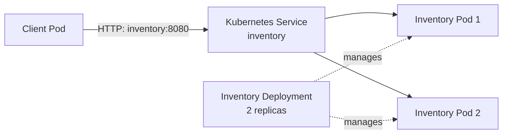
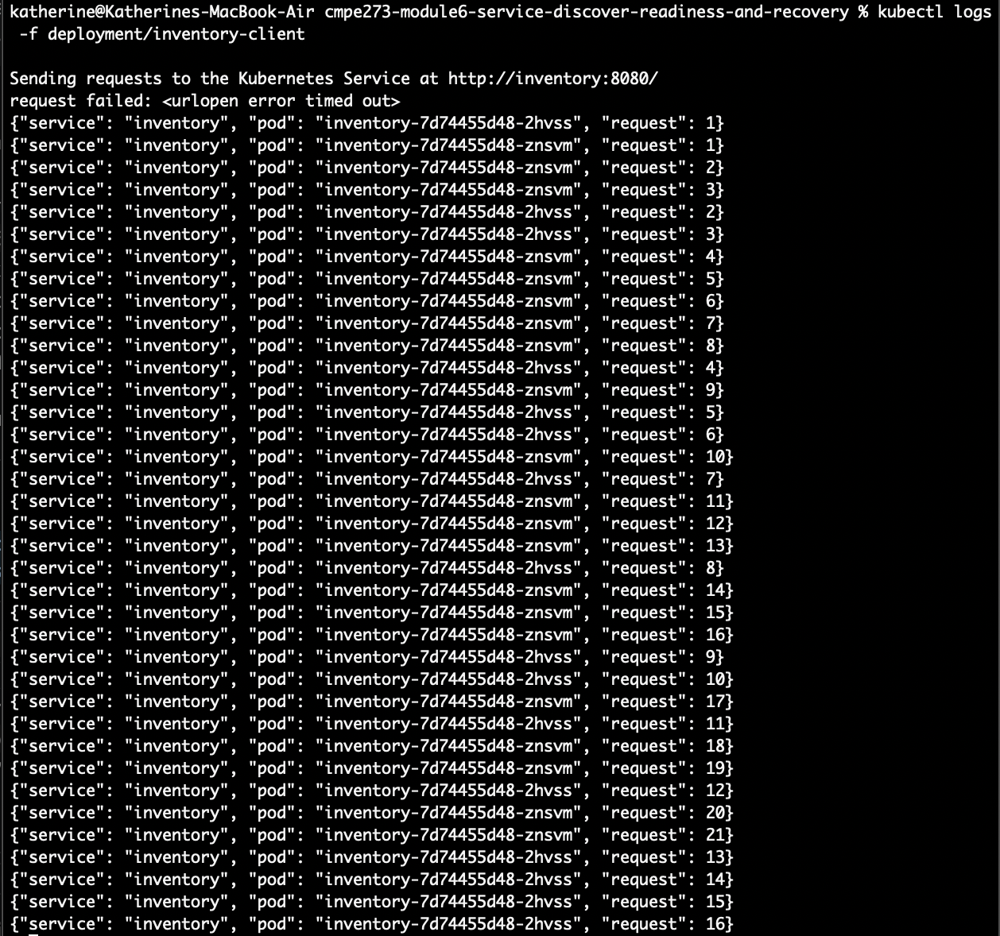
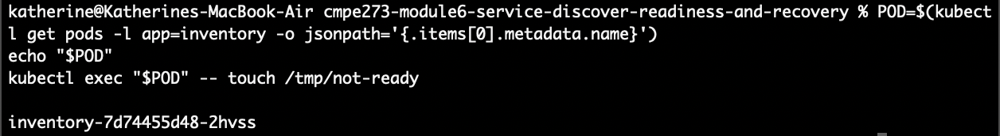
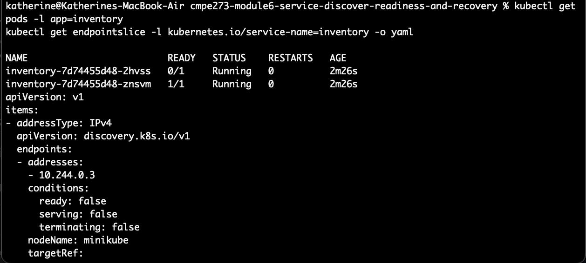
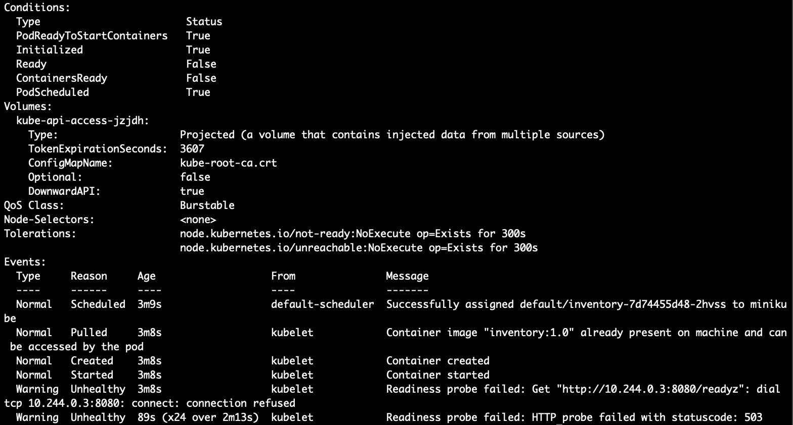
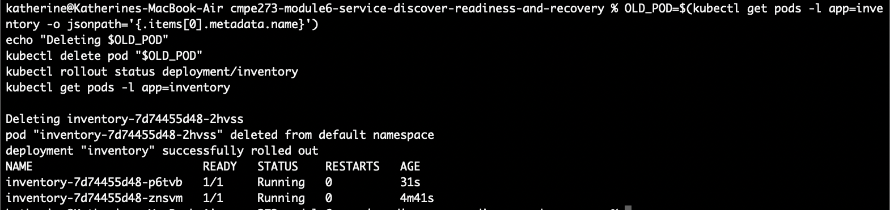
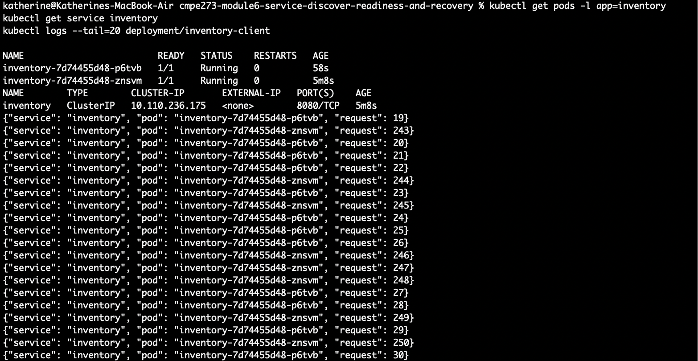
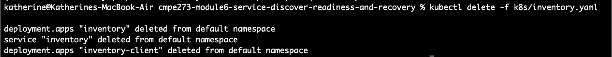

# CMPE 273 — Service Discovery, Readiness, and Recovery

This lab deploys an Inventory HTTP service with two replicas, a stable Kubernetes
Service named `inventory`, and one in-cluster client. The client calls
`http://inventory:8080/` (DNS/Service name), never a Pod IP. Responses include
the serving Pod's hostname so load balancing and replacement are observable.


## Prerequisites

- A working Kubernetes cluster and `kubectl` configured for it.
- Docker (or a compatible image builder).

## Instructions for deployment
### 1. Build and deploy

Build the image from the repository root:

```sh
docker build -t inventory:1.0 .
```

Make the image available to the cluster before deploying:

```sh
minikube image load inventory:1.0
```

```sh
kubectl apply -f k8s/inventory.yaml
kubectl rollout status deployment/inventory
kubectl rollout status deployment/inventory-client
kubectl get pods -l app=inventory -o wide
kubectl get service inventory
kubectl get endpointslice -l kubernetes.io/service-name=inventory
```

There should be two Running/Ready Inventory Pods and two ready Service
endpoints. The Service's ClusterIP/DNS name remains `inventory` regardless of
which Pods back it.

### 2. Verify service discovery and replica load balancing

Follow the single client Pod's output:

```sh
kubectl logs -f deployment/inventory-client
```

Each line is JSON containing a `pod` hostname. With two ready endpoints, repeat
requests should show both Inventory Pod names over time. The client loop opens
requests through the DNS name `inventory`, and does not discover or call Pod IPs.
Stop following the logs with Ctrl+C; this does not stop the client.

### 3. Readiness test

Select one Inventory Pod and make only its readiness endpoint fail. The
readiness flag is written inside that Pod; this does not stop its process or
fail its liveness probe.

```sh
POD=$(kubectl get pods -l app=inventory -o jsonpath='{.items[0].metadata.name}')
echo "$POD"
kubectl exec "$POD" -- touch /tmp/not-ready
```

Wait a few seconds for the readiness probe to update, then inspect the Pod and
Service endpoint conditions:

```sh
kubectl get pods -l app=inventory
kubectl get endpointslice -l kubernetes.io/service-name=inventory -o yaml
```

The selected Pod stays **Running** but becomes **0/1 Ready** and is removed from
the Service's ready endpoints. The other Pod stays ready. In the client logs,
normal requests should continue to succeed and identify only the other Pod.
Inspect the probe event to see the readiness endpoint failing with HTTP 503:

```sh
kubectl describe pod "$POD"
```

Restore readiness by removing the flag:

```sh
kubectl exec "$POD" -- rm /tmp/not-ready
kubectl get pods -l app=inventory
```

After the Pod returns to **1/1 Ready**, it returns to the Service endpoints and
can receive client requests again. Use Ctrl+C to stop each `-w` watch.

### 4. Pod failure and recovery

Record the current Inventory Pod names, then delete one Pod:

```sh
OLD_POD=$(kubectl get pods -l app=inventory -o jsonpath='{.items[0].metadata.name}')
echo "Deleting $OLD_POD"
kubectl delete pod "$OLD_POD"
kubectl rollout status deployment/inventory
kubectl get pods -l app=inventory
```

The Deployment controller creates a replacement with a different generated
Pod name to restore the desired count of two. Compare the old name to the names
in the updated Pod list. Confirm the Service name and client remain unchanged:

```sh
kubectl get pods -l app=inventory
kubectl get service inventory
kubectl logs --tail=20 deployment/inventory-client
```

The client continues using `inventory:8080`; requests resume through the
Service's current ready endpoints without updating the client or Service.

### Cleanup

```sh
kubectl delete -f k8s/inventory.yaml
```

## Architecture diagram



service discovery: 

stopping one pod:

stays running but becomes 0/1 ready:

readiness endpoint failing:

record pod names and delete one pod:

service name and client remain unchanged:

cleanup:


A stable service name is useful when pods can fail or be replaced because this gives clients a stable endpoint even when pods are deleted. Pods can get restarted, deleted, replaced, etc. so instead of keeping track of multiple pod IPs, we can just keep track of one service name. This demonstrates partial failure/abstraction in that some parts of the service change or fail but the service remains accessible with no changes in functionality.